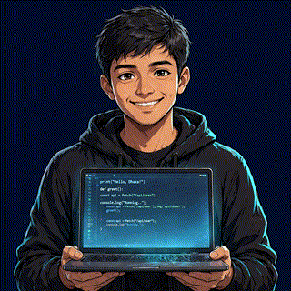
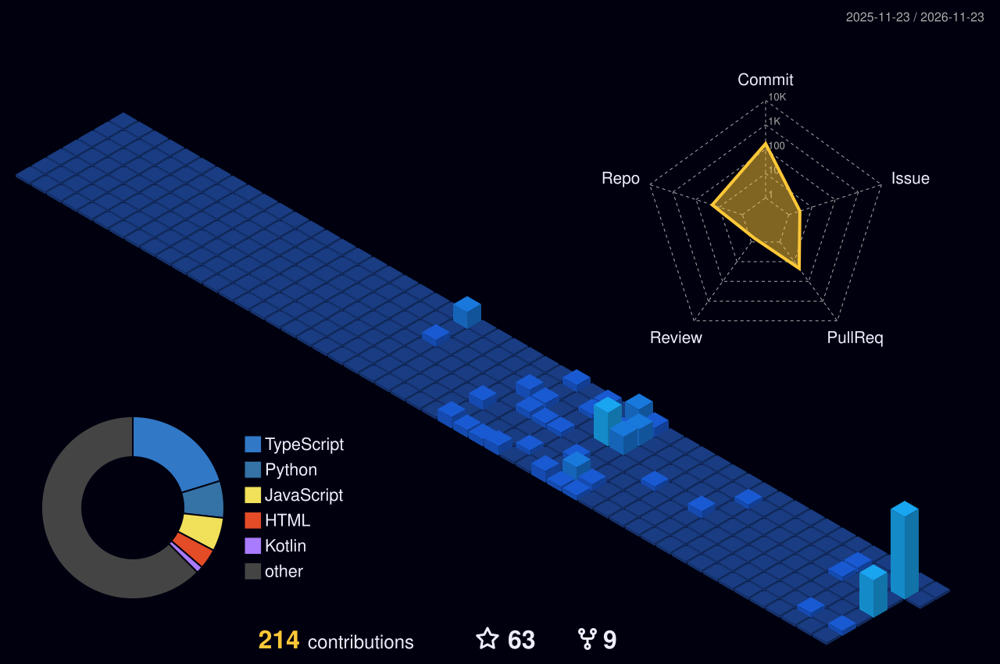

<!-- Living avatar: 4s Ken Burns loop on the anime portrait -->

## Featured Projects

<table>
<tr>
<td width="50%" valign="top">

### ManifestHawk
Chrome extension that detects, classifies, and inspects live video and audio streams — HLS, DASH, MP4, and audio — with search, filtering, and JSON / CSV export.

`JavaScript` `Chrome Extension APIs` `HTML` `CSS`

[Source Code](https://github.com/istiakrahman15/ManifestHawk)

</td>
<td width="50%" valign="top">

### iptv-api
A hand-curated IPTV channel database in JSON — Bangla, sports, news, kids, movies, music, and international channels — usable directly from the repository.

`JSON` `M3U` `HLS`

[Source Code](https://github.com/istiakrahman15/iptv-api)

</td>
</tr>
<tr>
<td width="50%" valign="top">

### Marlowe Shopp
A full-stack general store: storefront, product management, orders, and an admin panel, with JWT and bcrypt authentication and a Turso database.

`JavaScript` `Node.js` `Express` `Turso` `HTML` `CSS`

[Source Code](https://github.com/istiakrahman15/marlowe-shopp)

</td>
<td width="50%" valign="top">

### istiak-cli
An AI-powered terminal assistant with a React-based terminal UI. Ask questions, get answers, and work from the command line, powered by OpenRouter.

`TypeScript` `Node.js` `Commander` `Ink` `Vitest`

[Source Code](https://github.com/istiakrahman15/istiak-cli)

</td>
</tr>
<tr>
<td width="50%" valign="top">

### School Management System
A school management app covering students, teachers, classes, attendance, exams and results, fees, library, transport, hostel, notices, and a dashboard with charts.

`Next.js` `TypeScript` `Tailwind CSS` `shadcn` `Drizzle` `SQLite` `Turso` `NextAuth`

[Source Code](https://github.com/istiakrahman15/school-management)

</td>
<td width="50%" valign="top">

### ResumeOS
An AI-powered career toolkit: resume builder, ATS optimizer, cover letters, job tracker, portfolio publishing, PDF export, Stripe billing, and an admin panel.

`Next.js` `React` `TypeScript` `Tailwind CSS` `Supabase` `Drizzle` `Stripe` `OpenAI`

[Source Code](https://github.com/istiakrahman15/resume-os)

</td>
</tr>
</table>

[View all repositories →](https://github.com/istiakrahman15?tab=repositories)

## GitHub Statistics

## My Contributions in 3D

Commits rendered as a night city, refreshed every day. If the image is missing, run the “3D Contribution” workflow once from the Actions tab.

## Connect With Me

---

## Support My Work

If you find my projects useful or appreciate what I build, consider supporting my work. Your support helps me keep creating and improving.

---

*Ship it, then make it better.*

